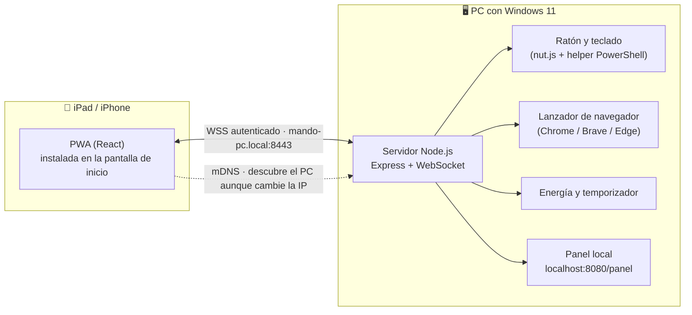

<div align="center">

# 📺 Mando PC

**Convierte tu iPad o iPhone en el mando a distancia de tu PC con Windows.**

Touchpad, teclado, volumen, reproducción, accesos directos a tus plataformas de streaming y apagado.
Todo desde el sofá o la cama, sin instalar nada en el móvil: es una PWA servida por tu propio PC.


</div>

---

## ✨ Por qué

Tienes el PC conectado a un monitor o a la tele y lo usas para ver series, YouTube o Twitch. Levantarte
a por el ratón cada vez que hay que pausar, subir el volumen o saltar la intro es un rollo.
**Mando PC** pone todo eso en la pantalla del iPad, con gestos de touchpad de verdad y sin pasar por
ningún servidor externo: el tráfico nunca sale de tu red.

## 🎯 Características

| | |
| --- | --- |
| 🖱️ **Touchpad con gestos** | Cursor con aceleración, clic, arrastrar, scroll con inercia, clic derecho y gestos de 3 dedos para avanzar o retroceder el vídeo |
| ⌨️ **Teclado** | Teclado de iOS conectado al PC, flechas, Enter, Esc, Tab, retroceso y combinaciones habituales |
| 🎬 **Reproducción** | Play/pausa, ±10 s, pista anterior/siguiente, subtítulos, pantalla completa del reproductor y F11 |
| 🔊 **Volumen** | Subir, bajar y silenciar, con la barra de volumen de Windows en pantalla (opcional) |
| 🚀 **Accesos directos** | Netflix, Prime Video, YouTube, Twitch, Movistar Plus+, RTVE Play… en modo quiosco y con perfil de navegador aislado. Se editan desde la propia app |
| 🪟 **Ventanas y navegador** | Atrás/adelante, recargar, cerrar pestaña, zoom, Alt+Tab, mostrar escritorio, cerrar la ventana de la tele |
| 🌙 **Energía** | Pantalla en negro, bloquear, hibernar, reiniciar, apagar y temporizador con **modo siesta** |
| 📡 **Estado en vivo** | Conexión y latencia, ventana activa del PC y si está sonando algo |
| 🖥️ **Panel en el PC** | Ventana con el QR, la instalación del certificado, los dispositivos conectados y el registro |
| 🔒 **Seguro por diseño** | HTTPS con CA propia, token de 256 bits, emparejamiento con código, listas blancas y solo red local |

## 🧩 Cómo funciona



- La **app** es una PWA en React que se instala en la pantalla de inicio y abre a pantalla completa.
- El **servidor** sirve la app por HTTPS, recibe órdenes por un WebSocket autenticado y las traduce en
  movimientos de ratón, pulsaciones de teclas, teclas multimedia o comandos de energía.
- Se anuncia en la red como **`mando-pc.local`** (mDNS), así que la app sigue funcionando aunque el
  router le cambie la IP al PC.

## 📋 Requisitos

- **Windows 10/11** en el PC.
- **Node.js 22** o superior.
- iPad o iPhone en la **misma red wifi** (marcada como *Red privada* en Windows).

> La versión actual está pensada para el **iPad en horizontal**. En vertical o en el iPhone funciona,
> pero en una sola columna con scroll.

## 🚀 Puesta en marcha

```bash
git clone https://github.com/<tu-usuario>/remote-control-pwa.git
cd remote-control-pwa
npm install
npm run build
npm start
```

La consola muestra la dirección de la app, la del certificado, un QR y un código de emparejamiento.
Los ficheros `config/settings.json` y `config/shortcuts.json` se crean solos en el primer arranque.

### 1️⃣ Firewall (una vez)

La primera vez que arrancas, Windows pregunta si deja pasar a Node.js: marca **solo Redes privadas**.
También puedes crear la regla desde una PowerShell de administrador:

```bash
powershell -ExecutionPolicy Bypass -File scripts\firewall.ps1
```

Tu wifi tiene que estar como **Red privada** en *Configuración → Red e Internet*.

### 2️⃣ Certificado en el iPad (una vez)

La app va por HTTPS con una autoridad de certificación propia que se genera en `data/certs`.

1. En el iPad, abre en Safari `http://IP-DEL-PC:8080/` (o escanea el QR de la consola) y pulsa **Descargar certificado**.
2. *Ajustes → Perfil descargado* → **Instalar**.
3. *Ajustes → General → Información → Ajustes de confianza de certificados* → activa **«Mando PC CA»**.

### 3️⃣ Instalar la app

Abre `https://mando-pc.local:8443/` en Safari → *Compartir* → **Añadir a pantalla de inicio**.
Usa ese nombre y no la IP. Se cambia con `mdnsName` en `config/settings.json`.
Ábrela siempre desde el icono: va a pantalla completa.

### 4️⃣ Emparejar

En el PC abre `http://localhost:8080/pair`: verás un código de 6 cifras (dura 5 minutos y admite 5 intentos).
Escríbelo en la app. A partir de ahí el iPad guarda un token largo y no hay que repetirlo.

<details>
<summary><b>¿Prefieres un PIN fijo?</b></summary>

Ponlo en `config/settings.json` y reinicia el servidor:

```json
"pairingPin": "tu-pin"
```

Mínimo 6 caracteres (si es más corto se ignora). La app pedirá ese PIN en lugar del código. Como es más
fácil de adivinar que un código que cambia, además del bloqueo por IP, más de 30 fallos en una hora
bloquean el PIN durante una hora. Déjalo vacío (`""`) para volver al código temporal.

</details>

> 💡 Las apps de la pantalla de inicio de iOS no comparten datos con Safari: el emparejamiento se hace
> dentro de la app instalada, no en Safari.

### 5️⃣ Arranque automático (opcional)

```bash
npm run autostart:install
```

Crea `MandoPC.vbs` en la carpeta *Inicio* de Windows: el servidor arranca sin ventana al iniciar sesión
y escribe en `data/server.log`. Para quitarlo: `npm run autostart:remove`.

### Arranque manual y panel

Doble clic en **`Mando PC.vbs`** (o en un acceso directo a él en el escritorio). Arranca el servidor en
segundo plano si no estaba ya y abre el **panel**: una ventana de Edge en modo app, sin consola, con la
dirección de la aplicación y su QR, la instalación del certificado, los dispositivos conectados y el
registro. Cerrar la ventana no detiene el servidor; para eso está el botón **Detener servidor** (pide una
segunda pulsación). Si no arranca, se abre `data/server.log` en el Bloc de notas.

El panel vive en `http://localhost:8080/panel` y solo responde al propio PC.
**`Iniciar Mando PC.cmd`** arranca el servidor con consola, útil para depurar.

## 🎮 La app

| Zona | Funciones |
| --- | --- |
| **Barra superior** | Conexión y latencia, ventana activa del PC y si está sonando algo, cuenta atrás del temporizador, atenuar la app, ajustes, energía |
| **Izquierda** | Accesos directos (editar, añadir, borrar, reordenar), cerrar la ventana de la tele, atrás/adelante, recargar, cerrar pestaña, zoom, Alt+Tab, mostrar escritorio |
| **Centro** | Touchpad y botones de clic |
| **Derecha** | Play/pausa, ±10 s, pantalla completa del reproductor, F11, espacio, pista anterior/siguiente, subtítulos, volumen, flechas, Enter, Esc, Tab, retroceso y teclado de iOS |

### 👆 Gestos del touchpad

| Gesto | Acción |
| --- | --- |
| 1 dedo | Mover el cursor (con aceleración) |
| Tocar | Clic |
| Doble toque y mantener | Arrastrar (seleccionar texto, barras de progreso, mover ventanas) |
| 2 dedos | Scroll con inercia |
| Tocar con 2 dedos | Clic derecho |
| 3 dedos en horizontal | Retroceder / avanzar el vídeo |

### 🌙 Energía

**Pantalla en negro** (el sonido sigue), **bloquear**, **hibernar**, **reiniciar** y **apagar**. Hibernar,
reiniciar y apagar piden una segunda pulsación en 4 segundos. El temporizador puede apagar, hibernar o
poner la pantalla en negro; con el **modo siesta** la pantalla se pone en negro al momento y el PC se
apaga o hiberna al acabar la cuenta atrás.

<details>
<summary>Detalles técnicos</summary>

- «Pantalla en negro» tapa la pantalla con una capa negra en vez de apagarla: en portátiles con Modern
  Standby (S0), apagar la pantalla suspende el PC.
- Hibernar usa `shutdown /h` y necesita la hibernación activada (`powercfg /a` debe mostrar «Hibernar»).

</details>

## 🔗 Accesos directos

Están en `config/shortcuts.json` y se editan desde la app. La app solo envía el `id`: el servidor busca
la URL en el JSON, así que nadie puede usarlo para abrir otra cosa.

```json
{
  "id": "twitch",
  "name": "Twitch",
  "url": "https://www.twitch.tv/",
  "color": "#9146ff",
  "browser": "chrome",
  "mode": "kiosk",
  "isolated": true,
  "closePrevious": true,
  "profile": "Default",
  "icon": "twitch.png"
}
```

| Campo | Valores | Qué hace |
| --- | --- | --- |
| `browser` | `chrome`, `brave`, `edge`, `default` | Navegador que se abre (si falta el elegido, usa Edge). Chrome trae activado el DRM (Widevine) que piden Netflix o Movistar Plus+; en Brave hay que activarlo |
| `mode` | `kiosk`, `fullscreen`, `normal` | `kiosk` quita todas las barras, ideal para la tele |
| `isolated` | `true` / `false` | Usa un perfil de navegador aparte (`data/browser/`): «cerrar lo anterior» nunca toca tu navegador normal. La primera vez inicia sesión en cada servicio y se queda guardada |
| `closePrevious` | `true` / `false` | Cierra la ventana de la tele anterior antes de abrir la nueva (solo con `isolated`) |
| `profile` | `Default`, `Profile 1`… | Perfil de Chrome/Edge que se usa con `isolated: false` |
| `icon` | `fichero.png` | Imagen opcional en `config/icons/` |

## ⚙️ Ajustes del servidor

`config/settings.json`:

| Clave | Por defecto | Descripción |
| --- | --- | --- |
| `httpsPort` | `8443` | Puerto de la app |
| `httpPort` | `8080` | Puerto HTTP solo para descargar el certificado, emparejar y el panel. No permite controlar nada |
| `pointerSpeed` | `1` | Multiplicador de velocidad del cursor |
| `scrollSpeed` | `1` | Multiplicador de velocidad del scroll |
| `seekSeconds` | `10` | Etiqueta de los botones de salto (el salto real lo decide el reproductor) |
| `showVolumeOsd` | `true` | Mostrar la barra de volumen de Windows al cambiar el volumen |
| `mdnsName` | `"mando-pc"` | Nombre en la red: `https://<mdnsName>.local:8443` |
| `pairingPin` | `""` | PIN fijo opcional (vacío = código temporal) |

## 🔒 Seguridad

Controlar el ratón y el teclado de un PC es delicado, así que la seguridad va primero y **todo se valida
en el servidor**, no solo en la app:

- 🏠 **Solo red local**: acepta conexiones de la propia máquina o de rangos de red privada.
- 🔑 **Token de 256 bits** generado en el primer arranque (`data/secret.json`). Para expulsar a todos los
  dispositivos, borra ese fichero y reinicia.
- 🔢 **Emparejamiento** con código de 6 cifras visible solo desde el propio PC (5 minutos, 5 intentos) o con
  PIN fijo opcional (bloqueo de 1 hora tras 30 fallos). Bloqueo de 15 minutos por IP tras 10 fallos.
  Comparaciones en tiempo constante.
- 🔐 **HTTPS** con CA local y **WebSocket** con comprobación de origen.
- ✅ **Listas blancas** de teclas y combinaciones; los accesos directos se validan contra el JSON; las URLs
  editadas desde la app solo pueden ser `http(s)` y se lanzan sin shell.
- ⚠️ **Confirmación en dos pasos** para hibernar, reiniciar y apagar.
- 🙈 Token, certificados, perfiles del navegador, registros y tu configuración local están en `.gitignore`.

## 🧪 Desarrollo

```bash
npm start      # servidor
npm run dev    # en otra terminal: Vite con recarga en caliente
```

Vite sirve la app en `http://localhost:5173` y reenvía la API y el WebSocket al servidor.

| Script | Para qué |
| --- | --- |
| `npm run build` | Compila la PWA en `client/dist` |
| `npm start` | Arranca el servidor |
| `npm run dev` | App en modo desarrollo |
| `npm run icons` | Regenera los iconos de la PWA |
| `npm run autostart:install` / `autostart:remove` | Arranque automático con Windows |

### 📁 Estructura

```
remote-control-pwa/
├── client/              # PWA en React + Vite
│   ├── public/          # manifest, service worker e iconos
│   └── src/
│       ├── components/  # Touchpad, Controls, Shortcuts, PowerSheet, Pairing…
│       └── remote.js    # cliente WebSocket
├── server/              # Servidor Node.js
│   ├── index.js         # HTTP/HTTPS, API y WebSocket
│   ├── security.js      # token, emparejamiento, filtros de red
│   ├── certs.js         # CA local y certificado del servidor
│   ├── input.js         # teclado, ratón y teclas multimedia
│   ├── launcher.js      # accesos directos en el navegador
│   ├── power.js         # energía y temporizador
│   ├── panel.js         # panel local del PC
│   ├── mdns.js          # anuncio mando-pc.local
│   └── *.ps1            # helpers de Windows en PowerShell
├── scripts/             # firewall, autoarranque, lanzador e iconos
├── config/              # settings.json y shortcuts.json (se generan solos)
└── data/                # token, certificados, perfiles y logs (no se sube)
```

## 🩹 Limitaciones conocidas

- Si la ventana activa se ejecuta como **administrador**, el ratón y el teclado no le llegan (Windows lo
  impide a procesos sin elevar).
- La pantalla completa del reproductor con **F** funciona en YouTube, Twitch y la mayoría; en otros usa
  «Doble clic».
- Play/pausa y pista anterior/siguiente usan las teclas multimedia de Windows: las recibe la app que
  tenga el control multimedia.
- Si cambia la IP del PC, el certificado del servidor se regenera solo (la CA no cambia) y
  `mando-pc.local` apunta a la nueva. Si algún dispositivo no resuelve nombres `.local`, reserva la IP del
  PC en el router.

## ⚖️ Aviso

Netflix, Prime Video, YouTube, Twitch, Movistar Plus+ y RTVE Play son marcas de sus respectivos
propietarios. Este proyecto no está afiliado a ninguno de ellos; los accesos directos solo abren sus
webs en tu navegador.

---

<div align="center">

Hecho con ☕ para no levantarse del sofá.

</div>
